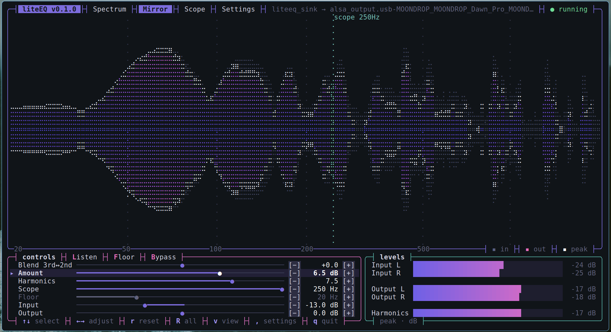

# liteEQ

**Version 0.1.1**

A lightweight terminal bass enhancer for Linux and Windows, written in Rust. It uses the same
DSP as the Calf Bass Enhancer in EasyEffects, with a dot
visualizer. The effect runs as a background service, so closing the app doesn't
stop your audio.



Needs **PipeWire** (with `pipewire-pulse` and `pactl`) on Linux, or
**Equalizer APO** on Windows ([see below](#windows)).

## Install

1. Install the dependencies for your distro:

   **Debian, Ubuntu, Mint, Pop!_OS**

   ```bash
   sudo apt install build-essential pkg-config clang libpipewire-0.3-dev libspa-0.2-dev pipewire-pulse wireplumber pulseaudio-utils
   ```

   **Fedora**

   ```bash
   sudo dnf install gcc pkgconf-pkg-config clang clang-devel pipewire-devel pipewire-pulseaudio wireplumber pulseaudio-utils
   ```

   **Arch, Manjaro, EndeavourOS**

   ```bash
   sudo pacman -S base-devel clang pipewire pipewire-pulse wireplumber libpulse
   ```

   **openSUSE**

   ```bash
   sudo zypper install gcc pkgconf-pkg-config clang-devel pipewire-devel pipewire-pulseaudio wireplumber pulseaudio-utils
   ```

   Only the Debian/Ubuntu commands have been tested. The others are based on each
   distro's package names, so a package may be named slightly differently.

   Most desktop distros already run PipeWire. Check with `pactl info`: the line
   `Server Name` should mention PipeWire.

   You also need [Rust](https://rustup.rs) 1.85 or newer:

   ```bash
   curl --proto '=https' --tlsv1.2 -sSf https://sh.rustup.rs | sh
   ```

2. Build and install:

   ```bash
   cargo install --path . --locked
   ```

3. Run it from anywhere:

   ```bash
   lite-eq
   ```

`cargo install` puts `lite-eq` in `~/.cargo/bin`. Make sure that folder is in your `PATH`.

## Windows

liteEQ runs as a plugin of [Equalizer APO](https://sourceforge.net/projects/equalizerapo/),
inside the Windows audio engine on your real output device. There is no added
latency, no virtual device and no background service, and the effect is active
whenever Windows plays audio, including at login.

1. Install Equalizer APO. In its Configurator, tick your speakers or headphones,
   then reboot if it asks.
2. Install [Rust](https://rustup.rs) 1.85 or newer (either the `x86_64-pc-windows-msvc`
   or the `x86_64-pc-windows-gnu` toolchain).
3. Build liteEQ and add the plugin to Equalizer APO:

   ```powershell
   cargo build --release
   target\release\lite-eq setup
   ```

   You can also do this in the app: open **Settings** and press **Install** (key
   `e`). The same place lets you choose which output gets the effect (key `d`)
   or remove it again (key `u`).
4. Run `target\release\lite-eq` (or copy it anywhere on your `PATH`) to control it.

`setup` copies `liteeq_vst.dll` into Equalizer APO's `VSTPlugins` folder, writes
`config\liteeq.txt` and adds `Include: liteeq.txt` to the end of `config.txt`
(backed up as `config.txt.liteeq-backup`). No admin rights are needed. Run it
again after rebuilding to update the plugin, and `lite-eq setup --remove` to
uninstall. `--device <PATTERN>` limits the effect to matching devices.

Settings are saved in `%APPDATA%\liteeq` and shared with the plugin through
`%ProgramData%\liteEQ\liteeq.shm`. Use a terminal with mouse support, such as
Windows Terminal.

If you use Peace, it may rewrite `config.txt` and drop the `Include: liteeq.txt`
line. Run `lite-eq setup` again if the app says "not set up" while audio plays.

## Build only

```bash
cargo build --release      # binary: target/release/lite-eq
cargo test
```

## Use

```bash
lite-eq          # open the app (starts the service if needed)
lite-eq stop     # stop the service
lite-eq --help      # all options
lite-eq --version   # show the version
```

While it runs, all audio goes through the effect, and your volume keys control the
real output device as usual. Stopping the service restores your previous output.

Switching outputs works while it runs: pick another device in your system sound
settings and liteEQ moves the effect there and stays the default output. If the
device disappears (headphones unplugged, Bluetooth disconnected), it moves to
the next available one by itself, with no restart needed.

- **Mouse:** click or drag sliders, right-click or double-click to reset.
- **Keyboard:** `↑↓` select, `←→` adjust, `r` reset, `l` listen, `b` bypass, `v` change view, `q` quit.
- **Settings** (button at the top, or `,`): start or stop the service, start at login, keep running after closing the app.

## Uninstall

```bash
lite-eq stop
cargo uninstall liteeq
```

If you turned on start at login, switch it off in Settings first.

## Changelog

**0.1.1**
- Linux: switching or unplugging the output device no longer breaks the effect.
  The service follows the device you pick and recovers when a device disappears.
- Linux: start at login waits for the real sound card, instead of attaching to
  PipeWire's silent placeholder output when it starts too early.

**0.1.0**
- First release: Linux (PipeWire service) and Windows (Equalizer APO plugin).

## Licence

MIT, see [LICENSE](LICENSE), with one exception: `src/dsp.rs` is a port of the
Calf Studio Gear Bass Enhancer and stays under the LGPL (version 2 or later, see
[COPYING.LGPL](COPYING.LGPL)). If you fork the project, keep that file under its
own licence.
